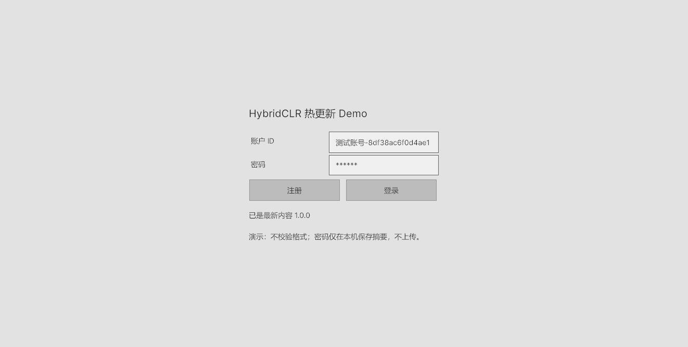
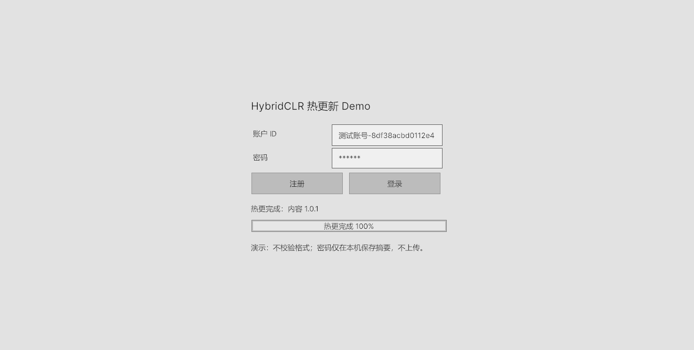
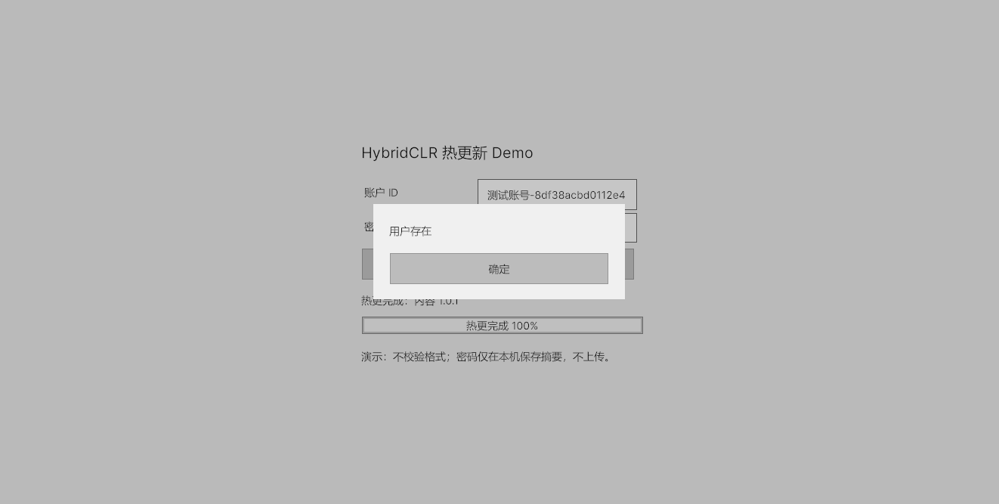
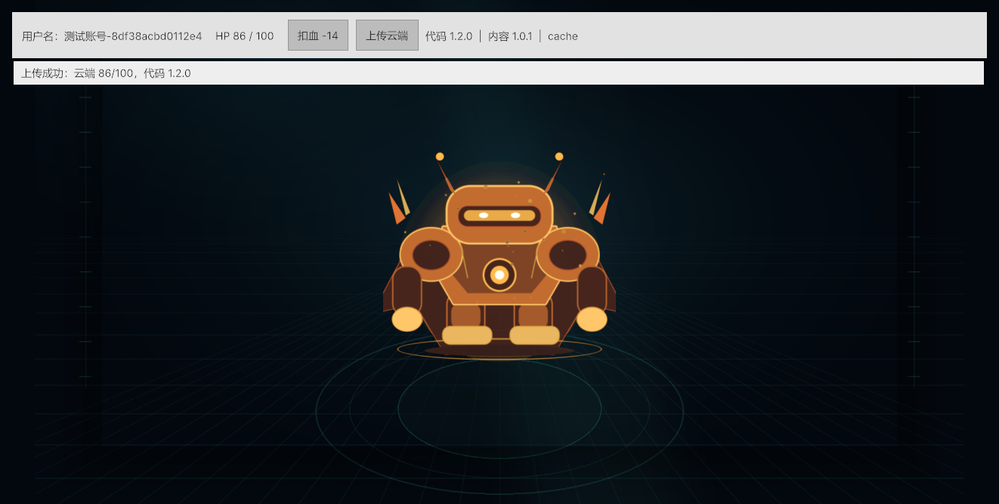

# 学习路线：HybridCLR + 手写 AssetBundle + 云同步

> 本文讲原理，动手步骤看 [手动流程.md](手动流程.md)。
> 文中的文件名、菜单名、版本号已按**当前工程**（`buildNumber = 16`、内容 `1.0.15`、代码 `1.4.0`）校对。
> 早期版本的一键菜单（`Hot Update Demo/1–4`、`Apply V2`、`Reset V1`）和编辑器脚本（`RuntimeSmokeTest.cs`、
> `DemoProjectBuilder.cs`、`HotUpdateBuildPipeline.cs`）都已删除，本文不再引用它们。

> 这是一份按学习顺序编排的完整讲义，不是 API 手册。
>
> 建议配合项目源码阅读：每章都有 **为什么这样做 / 替代方案为什么不行 / 底层原理 / 代码片段 / 实现思想**。
> UI 截图来自实际运行；代码用可复制、可搜索的代码块给出，避免截图里的代码无法检索。

> 🗄️ **账号在服务端**：`CloudServer/data/db.json` + `POST /api/v1/accounts/register`、`POST /api/v1/accounts/login`。
> 客户端不落盘、不用 `PlayerPrefs`，登录成功只把 `playerId` 放进内存里的 `PlayerSession`；服务器不可达时可以「离线开局」。
> 服务端逐段讲解见 [云服务端解读.md](云服务端解读.md)。

> 🧩 **内容只有一个包**：`ContentManifest`(SO) + 单个 `content_boot.bundle`，不用 AB 标签、没有 `catalog.assets`、
> 代码里也没有 `FindAsset` / `LoadAsset(string key)`；资源身份由 SO 的直接引用决定。

---

## 0. 先跑一遍，建立直觉

在项目根目录启动本地云服务：

```powershell
node CloudServer/server.js
```

打开 Unity 的 `Assets/Scenes/Start.unity`，Play：

1. Start 先检查热更；
2. 输入任意账号密码，点「注册」；
3. 再点一次「注册」，会弹「用户存在」；
4. 用错误密码点「登录」，会弹「账户或密码错误」；
5. 用正确密码登录，进入 Play；
6. 点「扣血」，HP 从 100 变 92；
7. 点「上传云端」，状态显示上传成功。

当前工作区（`buildNumber = 16`）：

```text
代码 1.4.0 | 内容 1.0.15 | builtin（首次）或 cache（热更后）
扣血 -8
贴图 ChineseHero
```

早期版本的样子（截图里的数值，仅作对照）：

```text
V1   代码 1.0.0 | 内容 1.0.0 | builtin   扣血 -7    青色机器人
V2   代码 1.2.0 | 内容 1.0.1 | cache     扣血 -14   金色机器人
```









> 学习时先不要急着改代码。先把 V1→V2 流程手动走通，再回头读实现。

---

## 1. 学习地图

| 阶段 | 要解决的问题 | 主要文件 | 验证方式 |
| --- | --- | --- | --- |
| 1 | 项目怎么分层 | `Assets/Scripts/Baseline` | 能说出每个类的职责 |
| 2 | Start 场景怎么检查热更、显示进度 | `StartSceneController.cs` | 有热更时看到进度条 |
| 3 | UI Toolkit 怎么写注册/登录/弹窗 | `StartUI.uxml`、`SimpleUI.uss` | 三个弹窗都出现 |
| 4 | 账号怎么存、密码怎么校验 | `AccountApi.cs`、`server.js` | 重复注册/错误密码被拦住 |
| 5 | 怎么进 Play、用户名怎么显示 | `PlayerSession.cs`、`GameHud.cs` | Play 左侧有用户名 |
| 6 | 扣血走哪条路 | `PlayerHealth.cs`、`GameHud.cs` | 点一下扣 `5 + DamageBonus` |
| 7 | HP 怎么上云 | `CloudSyncService.cs`、`server.js` | `db.json` 里多一条存档 |
| 8 | AB 怎么下载/校验/回退 | `AssetBundleManager.cs` | 断网/清缓存可回退 |
| 9 | 代码怎么热更 | `HotUpdateContracts.cs`、`HotUpdate` | 版本号变成新值 |
| 10 | 更新包怎么构建 | `BuildAssetBundles.cs` | `catalog.json` 的 `buildNumber` +1 |
| 11 | 怎么验证最终效果 | 日志关键词 + 管理页 | 三条链路都对得上 |
| 12 | 上线还差什么 | 本文最后一章 | 能列出生产改造项 |

---

## 2. 先看整体架构

```text
Start 场景
  StartSceneController
    -> CheckContent：AssetBundleManager.Initialize（带进度条）
    -> ProbeServer：GET /api/v1/health
    -> 注册/登录（POST /api/v1/accounts/*）
    -> PlayerSession.EnterOnline / EnterOffline
    -> SceneManager.LoadScene("Play")

Play 场景
  GameRoot
    -> AppConfig.Load（可被命令行 -server 覆盖）
    -> AssetBundleManager.Initialize
         -> 读内置 catalog
         -> 读上次缓存 catalog
         -> 读云端 catalog
         -> 下载/校验/回退
    -> LoadBootContent：从 content_boot.bundle 读 ContentManifest
    -> HotUpdateRuntime.TryInitialize（DLL 字节）
         -> Assembly.Load 动态程序集
         -> 实例化 IHotUpdateModule
    -> heroRenderer.sprite = manifest.heroSprite
    -> AutoLoadCloudSave：GET /api/v1/players/:id

CloudServer（server.js）
  -> POST /api/v1/accounts/register|login    账号
  -> GET / PUT /api/v1/players/:id           HP 存档（Bearer）
  -> GET /ServerData/AB/*                    AB 静态文件
  -> GET /                                   管理页

Editor
  -> BuildAssetBundles   编译热更 DLL、打 content_boot.bundle、写 catalog
```

### 分层原则

| 层 | 放什么 | 不应该放什么 |
| --- | --- | --- |
| UI 表现 | UXML/USS、按钮回调 | 下载逻辑、版本比较 |
| 流程编排 | `StartSceneController`、`GameRoot` | 具体文件解析 |
| 领域数据 | `PlayerHealth`、`PlayerSession` | UnityWebRequest |
| 基础设施 | `AssetBundleManager`、`CloudSyncService` | 具体 UI 文案 |
| 构建工具 | `Assets/Editor` | 运行时逻辑 |

### 为什么这样分

- 热更边界必须干净：Baseline 不能引用 HotUpdate；
- UI 改动不应影响 AB 逻辑；
- 下载失败、版本回退可以单独测试；
- 将来把 Node 换成别的后端，只改 `CloudSyncService`。

### 替代方案：全部写在一个 MonoBehaviour 里

能跑，但：

- 更新、登录、AB、HTTP 全耦合；
- 一处异常会拖垮整个 Start；
- 无法做自动测试；
- 热更边界容易破。

这不是“风格问题”，而是会直接影响可维护性和热更安全。

---

## 3. Start 场景：为什么更新要放在登录之前

### 3.1 需求

- 有热更时，Start 展示下载进度条；
- 没有热更时不显示（不欺骗用户）；
- 下载期间注册/登录不可用；
- 下载失败要能回退本地内容。

### 3.2 实现

`Assets/Scripts/Baseline/UI/StartSceneController.cs`

```csharp
private IEnumerator Start()
{
    yield return null;       // 等 UIDocument 建好 VisualElement 树
    Bind();
    yield return BootFlow();  // 内容检查 + 服务器探测并行，都结束才放开按钮
}
```

`BootFlow` 同时起两个协程，再等一个 20 秒的兜底：

```csharp
int pending = 2;
StartCoroutine(CheckContent(() => pending--));
StartCoroutine(ProbeServer(() => pending--));

float deadline = Time.realtimeSinceStartup + 20f;
yield return new WaitUntil(() => pending <= 0 || Time.realtimeSinceStartup >= deadline);

_ready = true;
SetAuthEnabled(true);
_offlineButton.SetEnabled(true);
```

`CheckContent` 创建临时 `AssetBundleManager`，只做检查/下载，不加载资源：

```csharp
AssetBundleManager updater = new AssetBundleManager();
bool progressVisible = false;

yield return updater.Initialize(
    _config,
    message => SetUpdateStatus(message),
    progress =>
    {
        if (!progressVisible)
        {
            progressVisible = true;
            _updateProgress.style.display = DisplayStyle.Flex;
        }

        _updateProgress.title = $"下载热更 {Mathf.RoundToInt(progress * 100f)}%";
        _updateProgress.value = Mathf.Clamp01(progress);
    });

if (updater.Source == "cloud")
    SetUpdateStatus($"热更完成：内容 {updater.ContentVersion}");
else
    _updateProgress.style.display = DisplayStyle.None;
```

### 3.3 为什么不在 Play 里下载

如果下载放在 Play：

- 用户已经登录，却要盯着游戏场景等待；
- 进度条没有合适的展示位置；
- 下载失败会影响“进入游戏”的体验；
- Start/Play 的职责会混乱。

放在 Start：

- 登录前完成内容准备；
- Play 启动更快；
- 失败也能在登录前提示。

### 3.4 底层原理

- `IEnumerator` 协程不是多线程，它在 Unity 主线程按帧推进；
- `UnityWebRequest` 在后台网络线程收发，协程每帧检查 `isDone/downloadProgress`；
- 下载进度用**已下载字节 / 总字节**计算，不是假动画；
- catalog 里的 `size` 是每个 bundle 的字节数，用于权重。

### 3.5 替代方案为什么不行

| 方案 | 问题 |
| --- | --- |
| 固定 2 秒假进度条 | 撒谎；大包/小包体验都不对 |
| 在 Play 场景下载 | 用户已经在游戏里，没有登录前的等待语义 |
| 直接 `yield return request.SendWebRequest()` | 能完成下载，但中间没有进度 |
| 用 `Resources.Load` 做热更 | Resources 进主包，无法替换 |
| Addressables 的 content update | 本身可行，但用户明确要求手写 AB，且会隐藏底层机制 |

### 3.6 实现思想

- **状态机**：检查中 → 下载中 → 完成/失败 → 允许登录；
- **真实进度**：只有 `progress` 回调真的发生时才显示进度条；
- **失败可回退**：下载失败不阻断登录，继续用本地内容；
- **按钮禁用**：避免用户在内容未准备好时进入 Play。

---

## 4. UI Toolkit：默认控件也能做出清晰界面

### 4.1 三个文件

```text
Assets/UI/StartUI.uxml   账号、密码、注册/登录、进度条、弹窗
Assets/UI/PlayUI.uxml    用户名、HP、扣血、上传云端
Assets/UI/SimpleUI.uss   只做排版，不修改按钮颜色
```

UI 结构：

```xml
<ui:TextField name="account-field" label="账户 ID" />
<ui:TextField name="password-field" label="密码" />

<ui:VisualElement class="actions">
    <ui:Button name="register-button" text="注册" />
    <ui:Button name="login-button" text="登录" />
</ui:VisualElement>

<ui:ProgressBar name="update-progress" title="下载热更" />
```

### 4.2 绑定

```csharp
_accountField = root.Q<TextField>("account-field");
_passwordField = root.Q<TextField>("password-field");
_registerButton = root.Q<Button>("register-button");
_loginButton = root.Q<Button>("login-button");

_passwordField.isPasswordField = true;
_registerButton.clicked += Register;
_loginButton.clicked += Login;
```

### 4.3 为什么用 UI Toolkit

| 方案 | 结果 |
| --- | --- |
| UI Toolkit | 用 UXML/USS 描述界面，运行时 `Q<T>` 查询，适合代码驱动 |
| UGUI | 也能做；需要 Canvas/EventSystem/Prefab，组件层级更重 |
| IMGUI / `OnGUI` | 编辑器工具常用，运行时样式和布局不适合正式 UI |
| 硬编码屏幕坐标 | 不同分辨率/宽高比会错位 |

UI Toolkit 的 `PanelSettings` 使用 `ScaleWithScreenSize`，参考分辨率 1280×720，
所以 Game View 和最终窗口比例相近时布局稳定。

### 4.4 弹窗为什么不用 EditorUtility

`EditorUtility.DisplayDialog` 只在 Editor 可用，打包后不存在。
所以项目用 UI Toolkit 做运行时弹窗：

```xml
<ui:VisualElement name="dialog-overlay" class="dialog-overlay" style="display: none;">
    <ui:VisualElement class="dialog">
        <ui:Label name="dialog-message" />
        <ui:Button name="dialog-ok" text="确定" />
    </ui:VisualElement>
</ui:VisualElement>
```

`display: none / flex` 控制显示，按钮使用默认主题。

### 4.5 实现思想

- 默认控件优先，避免为了“好看”引入一堆颜色和动画；
- 布局用 USS，文案/状态由 C# 更新；
- 弹窗只负责提示，不承载业务；
- UIDocument 必须等一帧再查询，避免 `rootVisualElement` 为空。

### 4.6 实际踩过的坑：PanelSettings 丢失

用 Editor 脚本生成场景时，第二个场景的 UIDocument 可能在保存时丢失
`panelSettings`，导致 Play 顶部 UI 完全不显示。

修复方法：

- 场景保存后重新 `OpenScene`；
- 找到 UIDocument；
- 重新赋 `panelSettings` 和 `visualTreeAsset`；
- 再保存。

当时靠一个 Editor 脚本在保存后重开场景、补 `panelSettings`（`DemoProjectBuilder`，已随旧流程删除）。

这说明：**Editor 生成场景时，序列化引用要实际验证**，不能只看代码有没有赋值。

---

## 5. 账号系统：注册、登录、弹窗

### 5.1 需求

- 账号/密码输入框下有两个按钮；
- 注册时如果账号存在：不覆盖，弹「用户存在」；
- 登录时账号不存在或密码错：统一弹「账户或密码错误」；
- 账号与密码由**服务端**保存，客户端不落盘；
- 服务器不可达时允许「离线开局」。

### 5.2 客户端：把请求发出去

`Assets/Scripts/Baseline/Core/AccountApi.cs` 对外只有三个方法：

```csharp
public static IEnumerator Register(string baseUrl, string account, string password,
                                   int timeoutSeconds, Action<AccountResult> onDone)
{
    return Post(baseUrl, "register", account, password, timeoutSeconds, onDone);
}

public static IEnumerator Login(string baseUrl, string account, string password,
                                int timeoutSeconds, Action<AccountResult> onDone)
{
    return Post(baseUrl, "login", account, password, timeoutSeconds, onDone);
}
```

`Post` 用 `UnityWebRequest` 发 `application/json`，把服务端返回的 `ok` / `data.playerId` / `error` 解成 `AccountResult`：

```csharp
AccountEnvelope envelope = JsonUtility.FromJson<AccountEnvelope>(text);

if (request.result != UnityWebRequest.Result.Success)
{
    onDone?.Invoke(AccountResult.Fail(envelope?.error ?? request.error));
    yield break;
}

onDone?.Invoke(AccountResult.Ok(envelope.data.account, envelope.data.playerId));
```

`StartSceneController.AuthRoutine` 只管流程和文案：

```csharp
if (result == null || !result.success)
{
    SetUpdateStatus("注册/登录失败。");
    ShowDialog(result != null ? result.message : "网络错误");
    yield break;
}

if (register)
{
    ShowDialog("注册成功，请登录");   // 注册后不自动登录
    yield break;
}

PlayerSession.EnterOnline(result.account, result.playerId);
SceneManager.LoadScene(playSceneName);
```

### 5.3 服务端：只有两张表

`CloudServer/server.js` 用一个 JSON 文件当数据库：

```json
{
  "schemaVersion": 2,
  "accounts": {
    "alice": { "password": "123456", "playerId": "player-6b86b273ff34", "createdAt": "..." }
  },
  "players": {
    "player-6b86b273ff34": { "hp": 79, "maxHp": 100, "revision": 2, "serverTimeUtc": "..." }
  }
}
```

注册分支（`handleAccounts`）：

```js
const record = db.accounts[account];

if (isRegister) {
  if (record) {
    sendJson(res, 409, { ok: false, error: '用户存在' });   // 已存在就不覆盖
    return true;
  }
  db.accounts[account] = { password, playerId: playerIdOf(account), createdAt: new Date().toISOString() };
  await persistDb();                                        // 临时文件 + rename 原子落盘
  sendJson(res, 201, { ok: true, data: { account, playerId: db.accounts[account].playerId } });
  return true;
}
```

登录分支：

```js
if (!record || record.password !== password) {
  sendJson(res, 401, { ok: false, error: '账户或密码错误' });
  return true;
}
```

完整的逐段讲解（含每个 Node 内置 API 的作用）见 [云服务端解读.md](云服务端解读.md)。

### 5.4 为什么放服务端，以及为什么现在是明文

先说结论：**位置对了，强度不对**。

放服务端的理由：

- 客户端可以被反编译，本地存什么凭据都没有意义；
- 换设备、多端登录需要同一份账号数据；
- 封号、改密、审计只能在服务端做。

但当前实现是明文 —— 这是刻意留给读者的坑，不是可以照抄的写法：

- 没有随机 salt；
- 没有慢哈希（bcrypt / scrypt / Argon2）；
- 明文 `!==` 比较还能被时序攻击；
- `db.json` 一旦泄露，所有账号直接裸奔。

生产至少要做到：

- 服务端存 `scrypt(password, salt)`；
- 传输走 HTTPS；
- 登录成功发**短期** JWT，并按账号校验 `playerId` 归属；
- 加登录失败次数限制。

### 5.5 为什么 `playerId` 由账号哈希得到

```js
function playerIdOf(account) {
  return 'player-' + crypto.createHash('sha256').update(account, 'utf8').digest('hex').slice(0, 12);
}
```

- 直接用账号名当 URL 段会有中文、空格、`/` 等非法字符；
- 哈希后长度固定、字符安全，且与账号一一对应；
- **但它可预测**：知道账号名就能算出 `playerId`，再加上"全客户端共享一个 token"，就能读写别人的存档。所以这只是"能跑"的折中。

生产应该用**不可预测**的 `playerId`（UUID），并在写入时校验"这个 token 属于这个 `playerId`"。

### 5.6 离线开局

```csharp
public static void EnterOffline()
{
    Mode = SessionMode.Offline;
    AccountName = "游客";
    PlayerId = "guest-" + Guid.NewGuid().ToString("N").Substring(0, 8);
}
```

- 离线时 `CloudSyncService.IsConfigured` 为 false，「上传云端」按钮直接禁用；
- 账号/密码根本不进 Play，场景切换只靠内存里的 `PlayerSession` 静态字段；
- 所以**重启就要重新登录** —— 这是刻意设计：客户端不保存任何凭据。

### 5.7 弹窗实现

```csharp
private void ShowDialog(string message)
{
    _dialogMessage.text = message;
    _dialogOverlay.style.display = DisplayStyle.Flex;
}

private void DismissDialog()
{
    _dialogOverlay.style.display = DisplayStyle.None;
}
```

### 5.8 实现思想

- `AccountApi` 只负责"发请求 + 解析"，不负责文案；
- `StartSceneController` 负责流程、按钮状态和弹窗；
- 失败分支明确返回，不继续登录；
- 注册成功不自动登录，让用户走一次登录：流程可控，也能反复演示；
- 错误提示优先用服务端返回的 `error`，这样"用户存在 / 账户或密码错误"只有一份实现。

---

## 6. 从 Start 到 Play：用户名怎么带过去

### 6.1 两个场景

```text
Assets/Scenes/Start.unity   登录页
Assets/Scenes/Play.unity    游戏页
```

Build Settings 顺序：

```text
0: Start
1: Play
```

### 6.2 登录成功

```csharp
PlayerSession.EnterOnline(result.account, result.playerId);
SceneManager.LoadScene(playSceneName);
```

`PlayerSession` 是静态类，只存内存：

```csharp
public static void EnterOnline(string account, string playerId)
{
    Mode = SessionMode.Online;
    AccountName = string.IsNullOrWhiteSpace(account) ? "游客" : account.Trim();
    PlayerId = playerId ?? string.Empty;
}
```

- 场景切换会销毁普通对象，但静态字段不会；
- `CloudSyncService.Awake()` 先从 `PlayerSession` 取 `PlayerId`，再由 `Configure(AppConfig)` 落定 `_baseUrl` / `_token`；
- Play 顶部显示 `AccountName`，离线时后面加「（离线）」。

### 6.3 为什么用场景，而不是一个场景切换面板

| 方案 | 问题 |
| --- | --- |
| 两个场景 | 职责清晰、可分别加载、符合用户要求 |
| 一个场景隐藏/显示面板 | 简单，但 Start/Play 生命周期混在一起；Play 的对象可能提前创建 |
| 不切场景，弹出登录框 | 不是用户要的“两个场景” |

### 6.4 用户名在左侧

`PlayUI.uxml`：

```xml
<ui:Label name="account-label" text="用户名：Guest" />
<ui:Label name="hp-label" text="HP 100 / 100" />
<ui:Button name="damage-button" text="扣血 -7" />   <!-- 只是占位文本，运行时被 NextDamagePreview 覆盖 -->
<ui:Button name="upload-button" text="上传云端" />
```

`GameHud`：

```csharp
_accountLabel.text = "用户名：" + PlayerSession.AccountName;
```

### 6.5 实现思想

- 场景只负责“这个界面有什么”；
- 用户会话用静态 `PlayerSession`，不放进场景对象；
- 用户名只做显示，云端 ID 由服务端按账号哈希给出；
- 不要把密码带进 Play，也不需要跨场景保存密码。

---

## 7. HP、扣血入口和热更公式

### 7.1 需求

- 玩家有 HP；
- Play 顶部有扣血按钮；
- 所有入口走同一个方法，结果一致；
- 数值来自热更 DLL，不是 SO。

### 7.2 一个方法，所有入口共用

`PlayerHealth.TakeDamage`：

```csharp
public int TakeDamage(int baseDamage)
{
    if (currentHp <= 0)
    {
        return 0;
    }

    int damage = PreviewDamage(baseDamage);
    currentHp = Mathf.Max(0, currentHp - damage);
    Changed?.Invoke(this);
    return damage;
}

public int PreviewDamage(int baseDamage)
{
    return Mathf.Min(currentHp,
        HotUpdateRuntime.CalculateDamage(baseDamage, currentHp, maxHp));
}
```

`GameHud`：

```csharp
private void OnDamageClicked()
{
    int damage = player.TakeDamage(PlayerHealth.BaseDamagePerStrike);
    SetStatus($"扣血 {damage}，当前 HP {player.CurrentHp}/{player.MaxHp}");
}
```

> 早期版本还有一个 `PlayerHealthEditor`，在 Inspector 上加了同样的按钮，这个脚本已经删除。
> 现在 UI 入口只有 Play 顶部的「扣血」，业务方法仍然是同一个 `PlayerHealth.TakeDamage`。

### 7.3 为什么不能直接改字段

```csharp
// 错误示例
currentHp -= 7;
```

问题：

- 不经过热更公式；
- 不触发 `Changed`，UI 不刷新；
- 多个入口容易算出不同结果；
- 无法预览下一次扣血。

### 7.4 为什么不用 ScriptableObject 存伤害

用户明确要求“改代码，不要用 SO 等”。

更根本的原因：

- SO 是数据热更，不是代码热更；
- 如果用 SO，V2 只换了数值，无法证明 DLL 被替换；
- SO 资源也需要一套加载/版本管理，仍然绕不开 AB；
- 把公式写在代码里，才能验证 HybridCLR 真的加载了新程序集。

### 7.5 底层原理

- `PlayerHealth` 属于 AOT；
- `IHotUpdateModule` 属于 AOT；
- `DemoHotUpdateModule` 属于热更 DLL；
- AOT 代码通过接口调用热更实现；
- `Assembly.Load` 后，CLR/HybridCLR 解析新元数据；
- 接口方法调用最终进入新 DLL 的 IL。

### 7.6 实现思想

- AOT 只依赖接口，不依赖实现；
- 热更代码可以改行为，但不能改 AOT 已编好的结构；
- UI 只调用一个业务方法，以后加入口也复用它；
- 用事件驱动显示，而不是每帧轮询。

---

## 8. 云同步：为什么用 HTTP，而不是 Firebase/PlayFab

### 8.1 当前实现

`Assets/Scripts/Baseline/Core/CloudSyncService.cs`

```csharp
string url = $"{_baseUrl}/api/v1/players/{UnityWebRequest.EscapeURL(_playerId)}";
byte[] body = Encoding.UTF8.GetBytes(JsonUtility.ToJson(save));

using (UnityWebRequest request = new UnityWebRequest(url, UnityWebRequest.kHttpVerbPUT))
{
    request.uploadHandler = new UploadHandlerRaw(body);
    request.downloadHandler = new DownloadHandlerBuffer();
    request.SetRequestHeader("Content-Type", "application/json");
    request.SetRequestHeader("Authorization", "Bearer " + _token);
    request.timeout = _config.requestTimeoutSeconds;
    yield return request.SendWebRequest();
}
```

服务端：

```text
GET  /api/v1/players/:id     读取存档（404 = 还没档）
PUT  /api/v1/players/:id     覆盖存档
Authorization: Bearer dev-token
```

请求体（`CloudSyncService.CreateSnapshot` 生成）：

```json
{
  "playerId": "player-a665a4592042",
  "hp": 92,
  "maxHp": 100,
  "hotUpdateVersion": "1.4.0",
  "clientTimeUtc": "2026-11-03T10:58:20.5654654Z",
  "schemaVersion": 1
}
```

服务端会**丢掉**请求体里的 `playerId`（以 URL 为准），并补上 `serverTimeUtc` 与自增的 `revision`：

```json
{
  "playerId": "player-a665a4592042",
  "hp": 92,
  "maxHp": 100,
  "hotUpdateVersion": "1.4.0",
  "clientTimeUtc": "2026-11-03T10:58:20.5654654Z",
  "schemaVersion": 1,
  "serverTimeUtc": "2026-11-03T10:58:20.575Z",
  "revision": 2
}
```

### 8.2 为什么不用 Firebase / PlayFab / Supabase

它们都能做云存档，但：

- 需要注册第三方账号、配置 SDK/密钥；
- 需要学习另一套数据模型；
- 会隐藏 HTTP 协议和 JSON；
- 不适合“从零看懂云同步”的教学目标；
- 本项目没有真实云端凭据。

对于这个 Demo，**零依赖 Node 服务**更透明：

- 一段 `server.js` 就能看懂；
- 路由、鉴权、持久化、错误码都可见；
- 部署到 Render/Railway/VPS 也容易。

替代方案不是“错”，而是目标不同。

### 8.3 为什么不用 PlayerPrefs 当云同步

PlayerPrefs：

- 只在本机；
- 换设备就没了；
- 不能多端共享；
- 不是网络请求，无法验证“上传到云端”。

### 8.4 为什么需要 `Authorization`

- 防止任何人用 playerId 改别人存档；
- 当前是共享 `dev-token`，只适合演示；
- 生产要登录后发短期 JWT，并做用户归属校验。

### 8.5 当前云端架构

```text
Unity --HTTP--> Node API --写文件--> CloudServer/data/db.json
                  ├─ accounts：账号、明文密码、playerId
                  └─ players ：HP 存档、revision、时间戳
Unity --HTTP--> Node /ServerData/AB/*  --> catalog.json + content_boot.bundle
浏览器   --> Node /                     --> 管理页（无鉴权）
```

数据文件不是数据库，适合教学，不适合高并发。

### 8.6 生产必须改什么

- 服务端权威计算 HP，不能信客户端；
- 数据库替代 JSON；
- 用户表、JWT、限流、审计；
- HTTPS；
- 版本冲突（revision / If-Match / 409）；
- 备份和监控。

### 8.7 实现思想

- 客户端只发快照，不参与存储实现；
- DTO 与服务端字段一一对应；
- 用 `CloudResult` 统一成功/失败；
- UI 只关心结果，不解析 HTTP。

---

## 9. 资源热更：为什么手写 AB，而不是 Addressables

### 9.1 先理解 AssetBundle

AssetBundle 是一个容器：

```text
content_boot.bundle                    ← 当前只有一个包
  ├── ContentManifest (ScriptableObject)
  ├── HotUpdate.dll (TextAsset 字节)
  └── ChineseHero (Sprite)
```

它解决的是“资源从哪来”，但不解决：

- 哪个版本是最新的；
- 文件有没有下载完整；
- 下载失败怎么办；
- 资源在 bundle 里的名字是什么；
- 依赖哪些其他 bundle；
- 缓存放哪；
- 旧版本怎么回退。

所以需要 **catalog + 管理器**。

### 9.2 catalog

```json
{
  "schemaVersion": 2,
  "buildNumber": 16,
  "contentVersion": "1.0.15",
  "builtAtUtc": "2026-11-03T11:02:44.1187212Z",
  "bundles": [
    {
      "name": "content_boot.bundle",
      "file": "content_boot.bundle",
      "sha256": "1ab799b4...cab4f",
      "size": 201476,
      "dependencies": []
    }
  ]
}
```

- `buildNumber`：真正用于比较大小（只增不减）；
- `contentVersion`：显示给人看；
- `sha256` / `size`：完整性校验；
- `bundles[].file`：下载时的**文件名**，不是资源名；
- **没有 `assets` 表**：资源和 bundle 的对应关系写在 `ContentManifest` 的直接引用里。

### 9.3 初始化流程

`AssetBundleManager.Initialize`：

```text
读内置 catalog
  -> 读上次缓存 catalog
  -> 请求云端 catalog
  -> 选 buildNumber 最大的
  -> 如果选中的是远端且未缓存：
       下载到 .downloading
       校验 SHA256
       原子替换 latest
  -> 否则直接用 builtin/cache
```

代码：

```csharp
ContentCatalog local = ReadCatalog(Path.Combine(LocalRoot, CatalogFileName));
ContentCatalog cached = ReadCatalog(Path.Combine(LatestCacheRoot, CatalogFileName));
ContentCatalog remote = null;
yield return FetchCatalog(remoteUrl, c => remote = c, error => LastWarning = error);

ContentCatalog best = PickHighest(local, cached, remote);

if (best == remote && remote != null)
{
    yield return DownloadCatalog(remote, progress, ok => downloaded = ok);
}
```

### 9.4 下载与原子替换

`DownloadCatalog` 的关键：

```csharp
foreach (BundleEntry bundle in catalog.bundles)
{
    string tempFile = destination + ".download";

    using (UnityWebRequest request = UnityWebRequest.Get(url))
    {
        request.downloadHandler = new DownloadHandlerFile(tempFile);
        request.SendWebRequest();

        while (!request.isDone)
        {
            progress?.Invoke((completedBytes + bundle.size * request.downloadProgress) / totalBytes);
            yield return null;
        }
    }

    if (!VerifyHash(tempFile, bundle.sha256)) { failed = true; break; }
    File.Move(tempFile, destination);
}
```

全部成功后才：

```text
把旧 latest 移到 backup
把 .downloading 移到 latest
删除 backup
```

失败则保留旧内容。

### 9.5 加载

没有 key，"加载资源"就退化成"加载那个固定包的清单对象"：

```csharp
public IEnumerator LoadBootContent(Action<ContentManifest> onLoaded, Action<string> onError)
{
    string bundleError = null;
    yield return EnsureBundleLoaded(ContentManifest.BundleName, e => bundleError = e);
    if (!string.IsNullOrEmpty(bundleError))
    {
        onError?.Invoke(bundleError);
        yield break;
    }

    AssetBundle bundle = _loadedBundles[ContentManifest.BundleName];
    ContentManifest[] manifests = bundle.LoadAllAssets<ContentManifest>();
    onLoaded?.Invoke(manifests[0]);
}
```

拿到 SO 之后，代码只认两个字段：

```csharp
codeLoaded = HotUpdateRuntime.TryInitialize(content.hotUpdateDll.bytes, out string codeError);
heroRenderer.sprite = content.heroSprite;
```

**资源名、bundle 名、依赖关系都从代码里消失了**。代价是只能整包换，收益是永远不会因为改名/改路径而找不到资源。

### 9.6 为什么不用 Addressables

Addressables 完全能实现这些功能，但：

- 用户明确要求“不要用 Addressables”；
- 学习目标就是看懂 catalog/下载/校验/缓存；
- Addressables 把关键机制封装了，出问题不容易定位；
- 手写版本更小、更透明。

如果做生产项目，Addressables 通常是更好的选择：
它有 content update、依赖分析、引用计数、CDN 配置、增量构建。

### 9.7 为什么不用 Resources

`Resources.Load`：

- 资源打进主包；
- 不能热更替换；
- 目录变大后加载变慢，难管理。

### 9.8 为什么不能直接 `AssetBundle.LoadFromFile` 就完事

如果没有 catalog：

- 不知道云端版本；
- 不知道下载哪个文件；
- 不知道文件是否完整；
- 无法回退旧版本；
- 资源名/依赖容易错。

### 9.9 为什么现在只打一个 bundle

- 代码和图片在这个 Demo 里**一起发布、一起回滚**，拆两个包只会多一份 catalog 和依赖关系；
- 一个 `content_boot.bundle` 只有 197 KB，全量重下的代价可以接受；
- 真要拆，`catalog.bundles[]` 里加条目、`dependencies` 写依赖就够了，`EnsureBundleLoaded` 已经支持递归加载依赖。

**什么时候该拆**：包体到几十 MB、改一张图要重下整个包、或者代码与美术由不同节奏发布时。

### 9.10 实现思想

- **版本号用整数**，不要字符串比较；
- **先下载临时文件，再原子替换**；
- **每个文件校验 hash**；
- **内容来源可观测**：builtin/cache/cloud；
- **失败有退路**：cache → builtin；
- **先设计 catalog，再写加载器**。

---

## 10. 代码热更：为什么是 HybridCLR，不是 Lua/ILRuntime

### 10.1 先理解 IL2CPP 的限制

Unity 打包 IL2CPP 时：

- C# 代码先转成 C++；
- 再编译成平台原生代码；
- 运行时没有 JIT；
- `Assembly.Load` 不能直接执行新 IL。

所以普通的“把 DLL 放进 AB，然后 Assembly.Load”在 IL2CPP 下**不够**。
HybridCLR 扩展了 IL2CPP：

- 增加元数据注册；
- 增加解释器；
- 支持动态加载程序集；
- 未改动代码继续走 AOT，改动代码走解释器。

### 10.2 为什么不选 Lua/xLua

Lua 方案：

- 需要把逻辑改写成 Lua；
- 多一门语言和运行时；
- 调试链路更长；
- 用户明确“不要用 Lua 系列”。

### 10.3 为什么不选 ILRuntime

ILRuntime 也是 C# 热更方案，但：

- 需要额外的 CLR 虚拟机；
- 与原生 AOT 的互操作更复杂；
- 对 Unity 新版本、泛型、性能要额外调优；
- HybridCLR 更接近 Unity 原生工作流，支持 AOT+Interpreter。

### 10.4 为什么不能只用 Mono 打包

Mono 支持 JIT，`Assembly.Load` 可以直接跑。
但：

- iOS/主机不能上 Mono JIT；
- 很多平台要求 IL2CPP；
- 用户要求 HybridCLR；
- Mono 不是 HybridCLR 的目标运行环境。

Editor Play Mode 是 Mono，所以 **Editor 验证 ≠ IL2CPP 验证**。

### 10.5 接口是热更边界

`IHotUpdateModule` 在 AOT：

```csharp
public interface IHotUpdateModule
{
    string DisplayVersion { get; }
    string Notes { get; }
    int DamageBonus { get; }
    int CalculateDamage(int baseDamage, int currentHp, int maxHp);
}
```

注意接口里**没有**资源 key / 图片名：热更代码只管数值，图片由 `ContentManifest` 决定。
两者能独立替换，是因为它们恰好被打进同一个包，而不是因为在接口上互相引用。

热更 DLL：

```csharp
public sealed class DemoHotUpdateModule : IHotUpdateModule
{
    public string DisplayVersion => "1.2.0";
    public int DamageBonus => 9;

    public int CalculateDamage(int baseDamage, int currentHp, int maxHp)
    {
        int raw = baseDamage + DamageBonus;
        bool enraged = maxHp > 0 && currentHp <= Mathf.CeilToInt(maxHp * 0.35f);
        if (enraged) raw *= 2;
        return Mathf.Clamp(raw, 1, Mathf.Max(1, currentHp));
    }
}
```

> 这就是 `Tools/PatchV2/DemoHotUpdateModule.cs` 里的写法（版本 `1.2.0`、`DamageBonus = 9`、残血翻倍）。
> 当前工程里跑的是另一份：`1.4.0`、`DamageBonus = 3`、没有狂暴分支。

加载：

```csharp
Assembly assembly = Assembly.Load(assemblyBytes);
Type moduleType = assembly.GetTypes()
    .FirstOrDefault(t => typeof(IHotUpdateModule).IsAssignableFrom(t)
                         && !t.IsAbstract
                         && t.GetConstructor(Type.EmptyTypes) != null);
Current = (IHotUpdateModule)Activator.CreateInstance(moduleType);
```

### 10.6 为什么 AOT 不直接引用 HotUpdate

如果 Baseline 引用 HotUpdate：

- 主工程编译期依赖热更程序集；
- 打包时可能把 HotUpdate 编进主包；
- 运行时可能出现两个同名程序集；
- 失去“换 DLL”的意义。

所以：

```json
{
  "name": "HotUpdate",
  "references": ["GUID:5223d2792a8dc004098dd951e3645d4e"],
  "autoReferenced": true
}
```

`GUID:5223d279…` 就是 `Assets/Scripts/Baseline/HotUpdateDemo.asmdef`。
`HotUpdate` 登记在 `ProjectSettings/HybridCLRSettings.asset` 的 `hotUpdateAssemblyDefinitions` 里，
打包时不会被 IL2CPP 编成 AOT 代码；但 HybridCLR 的 `PatchScriptingAssemblyList` 仍会把它的名字写进
`ScriptingAssemblies.json` —— 这是预期行为，不代表"HotUpdate 被打进包里了"。

反向依赖是单向的：HotUpdate → Baseline。

### 10.7 为什么场景不能直接挂热更脚本

场景序列化需要 AOT 类型信息。
如果 MonoBehaviour 只存在于热更 DLL：

- 场景加载时找不到脚本；
- IL2CPP 裁剪无法保证类型存在；
- 热更替换后类型标识不稳定。

本项目的做法：

- 场景只挂 AOT 组件（GameRoot/GameHud/PlayerHealth）；
- 热更代码是纯 C# 模块，不挂场景；
- 通过接口注入行为。

### 10.8 AOT 泛型与裁剪

- 热更代码只能使用 AOT 已经存在的泛型实例，或生成补充元数据；
- `link.xml` 保留 AOT 反射入口；
- HybridCLR 的 `GenerateAll` 生成 AOT 裁剪/bridge/补充元数据；
- 这些步骤在 Editor 的 Mono 下不需要，所以 Editor 通过不代表 IL2CPP 通过。

### 10.9 实现思想

- 接口尽量小；
- 热更模块无状态或状态由外部传入；
- 不把热更类型写进场景；
- 热更版本直接写在代码里，便于界面证明；
- 只改 HotUpdate 时，不重打 Player。

---

## 11. 构建流水线：一次发布到底生成了什么

### 11.1 编译 DLL

```csharp
CompileDllCommand.CompileDll(BuildTarget.StandaloneWindows64, false);
```

输出：

```text
HybridCLRData/HotUpdateDlls/StandaloneWindows64/HotUpdate.dll
```

复制成 TextAsset：

```text
Assets/HotUpdate/Build/HotUpdate.dll.bytes
```

### 11.2 打 AB

```csharp
var build = new AssetBundleBuild
{
    assetBundleName = ContentManifest.BundleName,   // "content_boot.bundle"
    assetNames = new[]
    {
        "Assets/HotUpdate/ContentManifest.asset",
        "Assets/HotUpdate/Build/HotUpdate.dll.bytes",
        heroPath,                                    // 由 manifest.heroSprite 反查，当前是 ChineseHero.png
    }
};

BuildPipeline.BuildAssetBundles(
    OutputDir,                       // "ServerData/AB"
    new[] { build },
    BuildAssetBundleOptions.ChunkBasedCompression | BuildAssetBundleOptions.ForceRebuildAssetBundle,
    BuildTarget.StandaloneWindows64);
```

注意 `heroPath = AssetDatabase.GetAssetPath(manifest.heroSprite)`：**打哪张图由 SO 决定**，不是写死路径。

### 11.3 写 catalog

- 计算每个文件 SHA256；
- 记录大小；
- 记录依赖（`built.GetAllDependencies(bundleName)`，当前是空数组）；
- 写 `contentVersion` / `buildNumber` / `builtAtUtc`；
- **不写资源 key 映射**：哪个图、哪个 DLL，由 `ContentManifest` 的直接引用决定。

### 11.4 初始包 vs 更新包

| 菜单 | `ServerData/AB` | `Assets/StreamingAssets/AB` |
| --- | --- | --- |
| `HotUpdate/1. Build Content` | 写新版本 | 保持旧基线 |
| `HotUpdate/2. Build Content + Sync Baseline` | 写新版本 | 复制成新基线 |

所以 V2 更新不会重新打 Player，只会让 Start 从云端下载。

### 11.5 为什么不能直接覆盖 StreamingAssets

StreamingAssets：

- 在安装目录/只读区域；
- 移动平台不能写；
- 没有版本管理；
- 覆盖后无法回退。

### 11.6 什么时候必须重新打包 Player

- 改 Baseline/AOT 代码；
- 改场景；
- 改 UI 的 UXML/USS（资源本身可能需要进包/AB，取决于加载方式）；
- 改 PlayerSettings；
- 更新 HybridCLR 版本/IL2CPP。

只改 `HotUpdate` 程序集或热更图片时，只发更新包。

### 11.7 实现思想

- 先固定发布单元：一个 `content_boot.bundle`（要拆再拆）；
- 版本号单调递增；
- catalog 是客户端和服务端的“合同”；
- 初始内容与更新内容分离；
- 构建结果必须能被自动测试。

---

## 12. 验证与排错：怎么知道它真的在工作

### 12.1 手工冒烟（当前没有自动化脚本）

工程里只剩一个编辑器脚本 `BuildAssetBundles.cs`，没有 `RuntimeSmokeTest`。
按顺序做这 7 步，每步都有可观察的证据：

1. `node CloudServer/server.js`，终端打印 `Content version: 1.0.15 (build 16)`；
2. 浏览器开 <http://127.0.0.1:8080>，能看到账号表和存档表；
3. 启动 exe，Start 页出现「已是最新内容 1.0.15」或「下载热更 xx%」；
4. 新账号注册 → 弹「注册成功，请登录」；再点一次注册 → 弹「用户存在」；
5. 错误密码登录 → 弹「账户或密码错误」；正确密码 → 进 Play；
6. Play 状态行出现「已从云端恢复 / 云端暂无存档」；点「扣血」HP 减 8；点「上传云端」状态行显示云端 HP；
7. 管理页刷新，能看到那条存档的 `hp` 和 `revision` 变了。

想把自动化加回来，最省事的是写一个 `-executeMethod` 入口，直接调用 `StartSceneController.Register()` /
`Login()` 和 `PlayerHealth.TakeDamage()`（都是 `public`），再断言 `PlayerSession.IsOnline` 与 HP 数值。

### 12.2 日志关键词

| 前缀 | 含义 |
| --- | --- |
| `[AB]` | catalog、下载、校验、加载 |
| `[HotUpdate]` | DLL 动态加载、模块版本 |
| `[Cloud]` | endpoint、playerId、请求 |
| `[Boot]` | 启动顺序、贴图 |
| `[HP]` | 扣血结果 |

### 12.3 常见错误

| 现象 | 原因 |
| --- | --- |
| 状态行 `代码 AOT fallback` | `ContentManifest.hotUpdateDll` 空，或 bundle 里没有 DLL |
| 贴图还是默认那张 | `heroSprite` 没换，或改的不是 SO 引用的图（当前是 `ChineseHero.png`） |
| 有进度条但 Play 还是旧版本 | 下载/校验失败，回退到 cache 或 builtin |
| 上传 401 | `appconfig.json` 的 `apiToken` 与 `API_TOKEN` 不一致 |
| 注册成功但登录失败 | 密码输错；账号在 `db.json` 里是明文，可直接核对 |
| UI 全空 | UIDocument 的 `PanelSettings` / `sourceAsset` 丢了 |
| 构建被拒绝 | 没装 Windows Build Support (IL2CPP) |

### 12.4 测试思想

- 测试真实入口，不复制业务逻辑；
- 测试结果要能自动判定，不靠肉眼；
- 失败信息要指出期望/实际；
- 截图是证据，不是测试本身；
- 测试完清理账号数据。

---

## 13. 为什么 Editor 能跑不代表 Player 能跑

### 13.1 Editor-only 代码

```text
Assets/Editor/
  BuildAssetBundles.cs     ← 只此一个，且只有它引用 HybridCLR.Editor
```

这些不会进 Player。

### 13.2 Editor 影响打包结果的方面

- 资源导入设置；
- 场景序列化引用；
- PlayerSettings/Quality；
- 裁剪/link.xml；
- 构建脚本生成的 AB/DLL；
- HybridCLR 生成物。

### 13.3 最终验收

旧流程是点 `Hot Update Demo/4. Build Windows IL2CPP Player` 一键打包；这个菜单已删除。
现在的做法是 `HybridCLR/Generate/All` → `File → Build Profiles → Windows x86_64 → Build`。

1. 运行 exe；
2. 注册/登录；
3. 改代码或换图，走一遍菜单 1（步骤见 [手动流程.md](手动流程.md)）；
4. 只覆盖服务器上的 `ServerData/AB`，重启 exe；
5. 确认版本号、扣血数值、贴图都变了，且内容来源是 `cache`；
6. 查看 `Player.log` 里的 `[AB]` / `[HotUpdate]` / `[Cloud]` 三类日志。

> 本节原来写的“当前机器缺少 IL2CPP 模块”“`HybridCLRData` 已清理”都已过时：
> 本机已装 Windows Build Support (IL2CPP)，`HybridCLRData/` 也在项目里。

---

## 14. 生产化路线：这个 Demo 还差什么

| 方向 | 当前 | 生产建议 |
| --- | --- | --- |
| 账号 | 服务端 JSON + 内存会话 | 服务端注册/登录 + 短期 JWT |
| 密码 | 明文存在 `db.json` | scrypt / Argon2 + salt |
| HP | 客户端上传 | 服务端权威计算/校验 |
| 存储 | JSON 文件 | Postgres/Redis |
| AB | 手写管理器 | Addressables/成熟框架 |
| 下载 | 简单重试 | CDN、断点续传、并发、限速 |
| 安全 | 共享 token | 短期 JWT、签名 catalog、HTTPS |
| 冲突 | last-write-wins | revision/409 |
| 发布 | 本地脚本 | CI/CD、灰度、回滚 |
| 监控 | 日志 | 指标、告警、崩溃上报 |

学习项目不是生产项目。**知道哪些地方是简化，比会背 API 更重要。**

---

## 15. 建议练习（按顺序）

1. 把 `DamageBonus` 从 3 改成 5，走一遍菜单 1 发一版，确认扣血变成 -10、内容号 +1。
2. 给热更公式加"暴击 30%"，但用固定种子，保证结果可复现。
3. 在 Play 顶部加「返回 Start」按钮，并处理 `GameRoot.OnDestroy` 里的 AB 卸载。
4. 给 `CloudSyncService` 加 `revision` 冲突检测：PUT 带 `If-Match`，服务端不匹配返回 409。
5. 加第二个 bundle（比如背景图），在 `catalog.bundles[]` 里加条目，让 `dependencies` 真正起作用。
6. 把 `ServerData/AB/catalog.json` 的 `sha256` 改错一位，验证下载后校验失败会回退。
7. 服务端把明文密码换成 `crypto.scryptSync` + salt，并迁移已有账号。
8. 给 `HotUpdateRuntime` 加"重新加载"逻辑：进出 Play 不重复 `Assembly.Load`。

---

## 16. 关键文件索引

| 目标 | 文件 |
| --- | --- |
| Start 更新/注册/登录 | `Assets/Scripts/Baseline/UI/StartSceneController.cs` |
| 账号接口 | `Assets/Scripts/Baseline/Core/AccountApi.cs` |
| 会话（在线/离线） | `Assets/Scripts/Baseline/Core/PlayerSession.cs` |
| Play 顶部 UI | `Assets/Scripts/Baseline/UI/GameHud.cs` |
| 启动编排 | `Assets/Scripts/Baseline/Core/GameRoot.cs` |
| HP | `Assets/Scripts/Baseline/Core/PlayerHealth.cs` |
| 手写 AB | `Assets/Scripts/Baseline/Core/AssetBundleManager.cs` |
| 内容清单 SO | `Assets/Scripts/Baseline/Core/ContentManifest.cs` |
| 动态 DLL | `Assets/Scripts/Baseline/Core/HotUpdateContracts.cs` |
| 云同步 | `Assets/Scripts/Baseline/Core/CloudSyncService.cs` |
| 构建 | `Assets/Editor/BuildAssetBundles.cs` |
| 当前热更数值 | `Assets/Scripts/HotUpdate/HotUpdateModule.cs` |
| 历史 V1 / V2 数值 | `Tools/PatchV1/`、`Tools/PatchV2/` |
| UI | `Assets/UI/StartUI.uxml`、`PlayUI.uxml`、`SimpleUI.uss` |
| 云服务 | `CloudServer/server.js` |
| 云服务讲解 | `Docs/云服务端解读.md` |

---

## 17. 最后：用一句话串起来

> Start 先检查/下载 AB，用户注册登录后进入 Play；
> Play 从手写 AB 管理器加载热更 DLL 和图片；
> AOT 通过接口调用热更代码，改变扣血公式；
> UI 按钮把 HP 通过 HTTP 上传到 Node 云服务；
> 发布 V2 只需替换服务器上的 AB，不需要重打 Player。

如果这五句话你能用自己的话讲清楚，这个项目就真正学会了。
