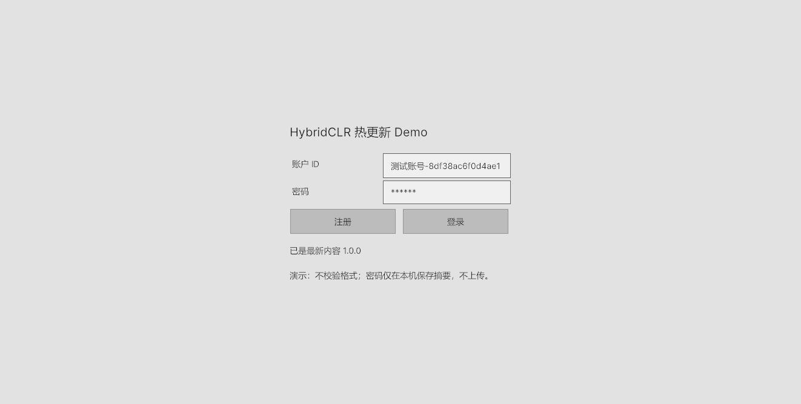
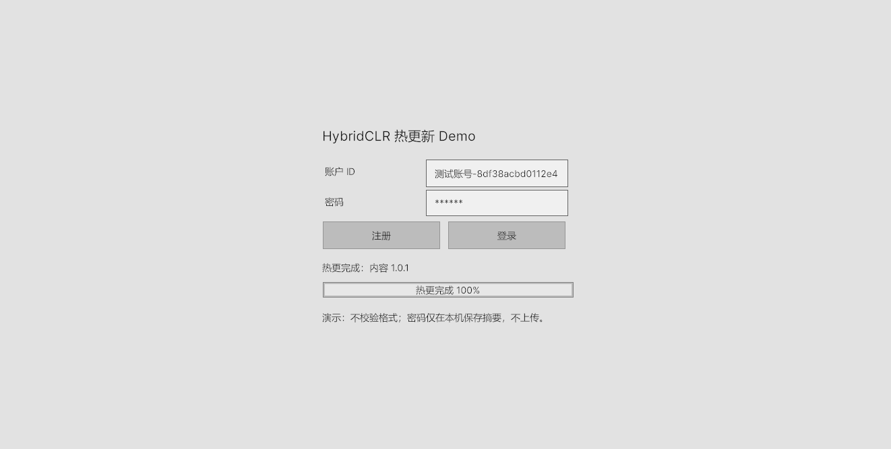
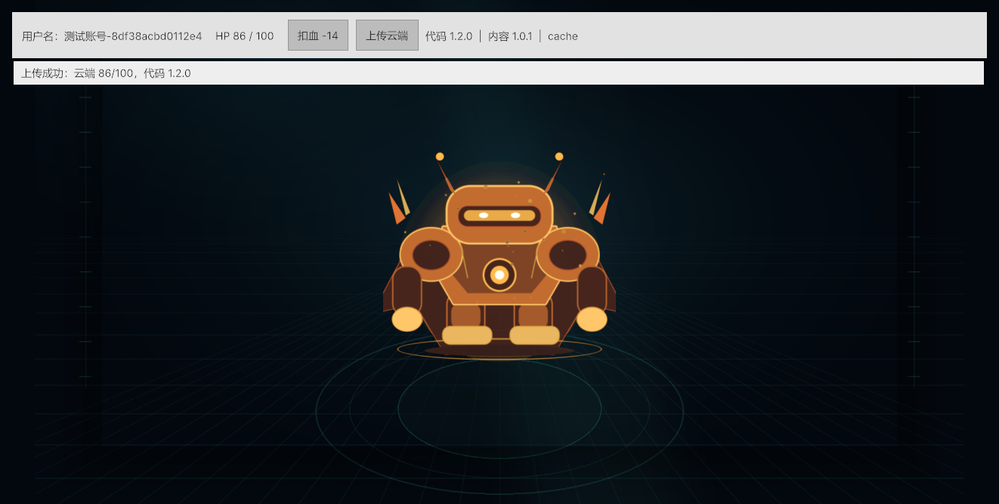

# HybridCLR + 手写 AssetBundle + 云同步（极简 UI）

一个 Unity 6 教学项目：**C# 代码热更 + AssetBundle 资源热更 + 云端保存 HP**。

- **两个场景**：`Start` 负责更新检查、注册/登录；`Play` 是游戏场景。
- **极简 UI**：UI Toolkit 默认控件，没有自定义按钮配色、卡片、渐变、动效。
- **有热更时**：Start 场景显示下载进度条，完成后才允许注册/登录。
- **账号系统**：注册、登录、重名/密码错误弹窗；不检查账号密码格式。
- **Play 左侧**：顶部最左边显示用户名；右侧紧挨着「扣血」「上传云端」两个按钮。
- **代码热更**：HybridCLR，纯 C#，不使用 Lua。
- **资源热更**：手写 `AssetBundleManager`，**不使用 Addressables**。
- **数值直接写在 C# 里**：伤害公式在 `HotUpdate.dll`，不用 ScriptableObject / 配置表。
- **云服务**：Node.js 零依赖服务，保存 HP JSON，同时托管 AB 文件。







> 当前仓库是 **V1**：青色机器人、`代码 1.0.0 / 内容 1.0.0 / -7`。
> 截图是发布 V2 后、**不重打 Player、只重启游戏**的效果：金色机器人、`代码 1.2.0 / 内容 1.0.1 / -14`。

## 环境

| 组件 | 版本 |
| --- | --- |
| Unity | 6000.2.14f1 |
| HybridCLR | 8.15.0（embedded package） |
| Node.js | 18+ |
| Player 打包 | Windows Build Support (IL2CPP) |

> HybridCLR 真正运行在 IL2CPP 上。当前机器缺少 Windows IL2CPP 模块，
> 因此完成的是 **Editor 端到端验证**，详见 [学习路线](Docs/学习路线.md)。

> 项目已清理掉生成的 `HybridCLRData` 以减小体积。构建 Player 前先执行
> `Hot Update Demo/1. Setup Project`，重新安装 HybridCLR 本地 il2cpp 数据。
> `Build Initial Content` / `Build Update Content` 不依赖该目录，可直接运行。

## 快速运行

### 1. 启动云服务

在项目根目录执行：

```powershell
node CloudServer/server.js
```

浏览器打开 <http://127.0.0.1:8080> 可查看状态。

### 2. Start 场景

打开 `Assets/Scenes/Start.unity`，点 Play。

启动时会先检查云端 AB：

- 没有热更：显示「已是最新内容 1.0.0」，注册/登录按钮可用；
- 有热更：显示「下载热更 xx%」进度条，下载并校验完成后显示「热更完成 100%」；
- 检查/下载期间，注册和登录按钮是禁用的。

然后：

- **注册**：输入任意账户 ID 和密码，点注册。
  - 新账号：弹窗「注册成功，请登录」；
  - 已存在：取消注册，弹窗「用户存在」，不会覆盖原密码。
- **登录**：
  - 用户名不存在或密码错误：弹窗「账户或密码错误」；
  - 正确：进入 Play。
- 不检查格式；密码仅在本机保存 SHA256 摘要，不上传。

### 3. Play 场景

顶部最左边是用户名：

```text
用户名：xxx   HP 100 / 100   [扣血 -7] [上传云端]   代码 1.0.0 | 内容 1.0.0 | builtin
```

- `扣血 -7`：走热更 DLL 里的伤害公式，HP 变成 93。
- `上传云端`：紧挨在右侧，把当前 HP、热更代码版本、时间戳 PUT 到 Node 服务。
- 也可以选中 `Player`，在 Inspector 的 `PlayerHealth` 下点同样的扣血按钮。
- 状态行显示「上传成功：云端 93/100，代码 1.0.0」。

云数据保存在 `CloudServer/data/players.json`。

## 发布 V2：代码和图片一起热更

保持 Node 服务运行：

1. 菜单 `Hot Update Demo/Apply V2 Demo Patch (code + image)`
   - 伤害从 `+2` 改成 `+9`；
   - HP ≤ 35% 时伤害翻倍；
   - 金色机器人。
2. 等编译完成。
3. 菜单 `Hot Update Demo/3. Build Update Content (server only, bump version)`
   - 只更新 `ServerData/AB`，`StreamingAssets/AB` 保持 V1；
   - 内容版本变成 `1.0.1`。
4. 停止 Play，再点 Play：
   - Start 自动发现 1.0.1，显示下载进度条；
   - 完成后注册/登录（或使用已有账号）；
   - Play 顶部变成 `代码 1.2.0 | 内容 1.0.1 | cache`；
   - 金色机器人；按钮变成「扣血 -14」，HP 100 → 86；
   - 上传后云端版本为 `1.2.0`。

### 回到 V1

1. `Hot Update Demo/Reset V1 Demo Patch (code + image)`，等编译。
2. `Hot Update Demo/Clear Downloaded AB Cache`。
3. `Hot Update Demo/2. Build Initial Content (copy into StreamingAssets)`。
4. 重新 Play。

## 菜单

| 菜单 | 作用 |
| --- | --- |
| `Hot Update Demo/1. Setup Project` | 生成 Start/Play 场景、UI 引用、HybridCLR 设置 |
| `Hot Update Demo/2. Build Initial Content` | 编译 V1 DLL、打两个 AB、复制进 StreamingAssets |
| `Hot Update Demo/3. Build Update Content` | 只更新 ServerData/AB，版本 +1 |
| `Hot Update Demo/4. Build Windows IL2CPP Player` | GenerateAll + 重新打 AB + 打 IL2CPP 包 |
| `Hot Update Demo/Apply V2 Demo Patch` | 切到 V2 代码与金色图 |
| `Hot Update Demo/Reset V1 Demo Patch` | 切回 V1 |
| `Hot Update Demo/Clear Downloaded AB Cache` | 清除 persistentDataPath 下载缓存 |
| `Hot Update Demo/Check Environment` | 检查 HybridCLR、IL2CPP 模块、场景、AB |
| `Hot Update Demo/Run Play Mode Smoke Test` | 自动注册/重复注册/错误密码/登录/扣血/上传 |

## 代码入口

| 看什么 | 文件 |
| --- | --- |
| Start 注册/登录/进度条 | [`StartSceneController.cs`](Assets/Scripts/Baseline/UI/StartSceneController.cs) |
| 本地账号库 | [`AccountStore.cs`](Assets/Scripts/Baseline/Core/AccountStore.cs) |
| 用户名 → 云端 playerId | [`PlayerSession.cs`](Assets/Scripts/Baseline/Core/PlayerSession.cs) |
| Play 顶部 UI | [`GameHud.cs`](Assets/Scripts/Baseline/UI/GameHud.cs) |
| 启动与热更加载 | [`GameRoot.cs`](Assets/Scripts/Baseline/Core/GameRoot.cs) |
| 手写 AB 管理器（含进度） | [`AssetBundleManager.cs`](Assets/Scripts/Baseline/Core/AssetBundleManager.cs) |
| 动态加载 DLL | [`HotUpdateContracts.cs`](Assets/Scripts/Baseline/Core/HotUpdateContracts.cs) |
| HP 与热更公式 | [`PlayerHealth.cs`](Assets/Scripts/Baseline/Core/PlayerHealth.cs) |
| 云同步 | [`CloudSyncService.cs`](Assets/Scripts/Baseline/Core/CloudSyncService.cs) |
| 热更数值 V1 | [`DemoHotUpdateModule.cs`](Assets/Scripts/HotUpdate/DemoHotUpdateModule.cs) |
| 热更数值 V2 | [`Tools/PatchV2`](Tools/PatchV2/DemoHotUpdateModule.cs) |
| 构建流水线 | [`HotUpdateBuildPipeline.cs`](Assets/Scripts/Editor/HotUpdateBuildPipeline.cs) |
| 云服务 | [`server.js`](CloudServer/server.js) |

UI 资源：

```text
Assets/UI/StartUI.uxml    账号、密码、注册/登录、进度条、弹窗
Assets/UI/PlayUI.uxml     用户名、HP、扣血、上传云端
Assets/UI/SimpleUI.uss    只有排版；按钮/输入框用默认主题
```

## 教程

- [学习路线（完整讲义）](Docs/学习路线.md)：按顺序讲清为什么、替代方案、底层原理、代码与实现思想

## 没有使用

- 没有 Lua / xLua / ILRuntime。
- 没有 Addressables。
- 没有用 ScriptableObject 或配置表存伤害数值。
